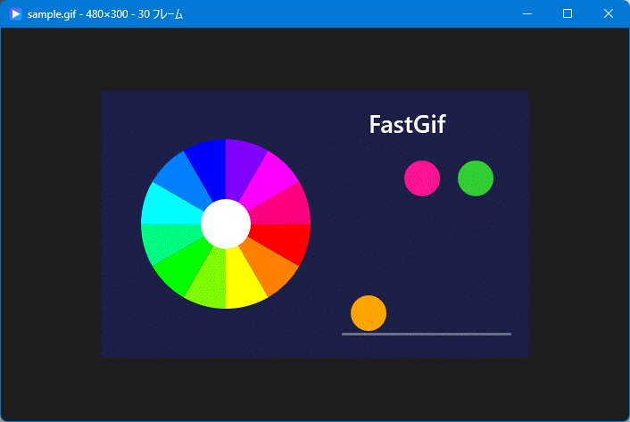

# FastGif

**English** | [日本語](README.ja.md)

A tiny, fast animated GIF viewer for Windows 11. Its main goal is to put the **first frame on screen as quickly as possible** and then play the animation.



- Written in C++ with the Win32 API only, without the C runtime (CRT)
- **Single self-contained exe (about 46 KB, of which about 16 KB is the icon). No extra DLLs.**
- Uses only DLLs that ship with Windows (kernel32 / user32 / gdi32 / dwmapi)
- Includes its own GIF decoder; it does not use WIC

## Features

- Fast startup. The first frame is decoded in about 0.2–1.9 ms on our test files, compared with 0.45–9.1 ms for WIC.
- Smooth, accurate playback with a high-resolution timer
- Keeps up with large, fast GIFs (for example 1920×1080 at 100 fps). If playback starts to fall behind, FastGif switches to decoding frames on a background thread and keeping them in memory, already scaled to the window.
- Large images are scaled down to fit the window, keeping the aspect ratio. Smaller images are shown at 100% in the center.
- The mouse wheel goes to the previous or next GIF in the same folder. Files are sorted by name, numbers are compared numerically, and the list wraps around.
- Remembers the window position, size and maximized state
- Supports drag & drop, the Open dialog, and command-line arguments, so file association works too
- Fullscreen mode, frame stepping, and a choice of backgrounds for transparent areas

## Usage

```
fastgif.exe <file.gif>
```

You can also drop a GIF onto the exe or onto the window, or press Ctrl+O.

To open GIFs with FastGif from Explorer, right-click a GIF, choose "Open with", then "Choose another app", select `fastgif.exe`, and pick "Always".

### Controls

| Key / mouse | Action |
|---|---|
| Space | Play / pause |
| ← / → | Previous / next frame (pauses playback) |
| Home | Go to the first frame |
| Mouse wheel | Up: previous GIF / down: next GIF in the same folder |
| PageUp / PageDown, ↑ / ↓ | Previous / next GIF |
| F / F11 / Enter / double-click | Toggle fullscreen |
| B | Change the background behind transparent areas (checkerboard / dark gray / white / black) |
| Ctrl+O | Open a file |
| F1 / right-click | Show help |
| Esc | Leave fullscreen, or quit |

### Window settings (fastgif.ini)

- When you close the window, its position, size and maximized state are saved to `fastgif.ini`. The next launch opens with the same position and size.
- The file is saved next to the exe. **Only if that folder is not writable** (for example `Program Files`), it is saved to `%APPDATA%\FastGif\fastgif.ini` instead. Loading follows the same order.
- If the saved position is on a monitor that is no longer connected, the saved size is kept and the window is centered on the monitor under the mouse cursor.

## How it gets the first frame up fast

- The file is memory-mapped. At startup only the header and the location of the first frame are parsed. Later frames are parsed as playback reaches them.
- The first frame is decoded on a worker thread while the main thread creates the window.
- The DWM window-open animation is turned off, so the window appears immediately.
- The folder is not scanned at startup. It is scanned once, the first time you move to another file with the wheel or PageUp/PageDown.
- shell32 (drag & drop) and comdlg32 (Open dialog) are loaded only when they are first used.
- The LZW decoder stores dictionary entries as an offset and length into the output already written, and copies strings directly from there.
- After each frame is shown, the next frame is decoded ahead of time. Frames switch on a high-resolution waitable timer at absolute deadlines, so timing errors do not add up.
- Images are scaled down with FastGif's own area-averaging scaler (SSE4.1, split across CPU cores). It looks the same as GDI's HALFTONE mode and is about 16 times faster.

## Large GIFs

FastGif starts by decoding frames on the UI thread, because that shows the first frame fastest. It checks every frame whether the work finished within the frame's delay. If 6 of the last 8 frames were late, it switches to a background mode:

- The rest of the file is read ahead in one go (`PrefetchVirtualMemory`), so slow drives do not stall decoding with small page-fault reads.
- A worker thread decodes frames, adds the background, scales them to the window size and stores them in memory. Later loops play from memory.
- Memory use is limited to half of the free physical memory, up to 3 GB. If the frames do not all fit, the frames furthest from the current position are dropped first.
- Resizing the window or changing the background makes the worker rebuild the frames at the new size. Until then, the existing frames are stretched.

A few slow frames at the start are ignored, so the first frame still appears as fast as before.

## Building

You need Visual Studio 2022 with the "Desktop development with C++" workload.

```
build.bat
```

The exe is written to `publish\fastgif.exe`, and intermediate files go to `build\`.

| Script | Purpose |
|---|---|
| `test\build_test.bat` | Builds `test_wic.exe` (compares every frame from FastGif's decoder with WIC) and `bench.exe` (time per frame for decoding and scaling) |
| `tools\make_icon.ps1` | Regenerates the icon (`res\fastgif.ico`) |
| `tools\make_sample_gif.ps1` | Regenerates the sample animation (`docs\sample.gif`) |

## Notes

- A delay of 0 (not set) is shown as 100 ms. Every other delay is used as written, including 1/100 s (10 ms).
- The loop count stored in the file is ignored, and the animation always loops.
- Disposal method 2 (restore to background) clears to transparent, the same as in browsers.
- The largest image size supported is 64 million pixels (about 8192×8192).

## License

[MIT](LICENSE)
